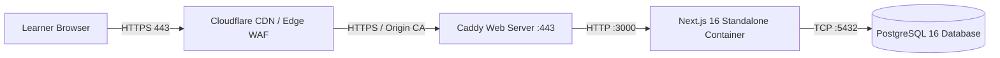

# Production Deployment Guide: Cloudflare & Caddy

Dokumen panduan konfigurasi domain, DNS, dan reverse proxy untuk `netloka.biz.id`.

---

## 1. Arsitektur Infrastruktur Produksi



---

## 2. Konfigurasi Cloudflare

1. **DNS Management:**
   - **Type:** `A`
   - **Name:** `netloka.biz.id` / `@`
   - **IPv4 Address:** `[VPS_PUBLIC_IP]`
   - **Proxy status:** `Proxied` (Orange Cloud)

2. **SSL/TLS Encryption Mode:**
   - Mode: **Full (Strict)**
   - Always Use HTTPS: **ON**
   - Minimum TLS Version: **TLS 1.2**
   - Opportunistic Encryption: **ON**
   - TLS 1.3: **ON**

3. **Security / WAF Rules:**
   - Security Level: **Medium**
   - Bot Fight Mode: **ON**
   - Rate Limiting: 100 requests per 10s per IP (protecting `/api/auth/` and `/api/labs/`).

---

## 3. Deployment Langkah demi Langkah (VPS)

1. **Clone repository:**
   ```bash
   git clone https://github.com/notyourkise/NetLoka.git /opt/netloka
   cd /opt/netloka
   ```

2. **Setup environment file (`.env`):**
   ```bash
   cp .env.example .env
   # Edit .env dengan kata sandi database dan NEXTAUTH_SECRET yang kuat:
   # openssl rand -base64 32
   chmod 600 .env
   ```

3. **Jalankan database dan migrasi forward-only:**
   ```bash
   # Jalankan database postgresql terlebih dahulu
   docker compose -f docker-compose.prod.yml up -d postgresql

   # Jalankan migrasi forward-only terverifikasi (TIDAK BOLEH db push)
   docker compose -f docker-compose.prod.yml --profile maintenance run --rm migrate
   ```

4. **Jalankan aplikasi dan reverse proxy Caddy:**
   ```bash
   docker compose -f docker-compose.prod.yml up -d --build app caddy
   ```

5. **Verifikasi status kesehatan aplikasi:**
   ```bash
   curl -i https://netloka.biz.id/api/health
   ```

---

## 4. Hubungan Lingkungan Staging & Cloudflare

Untuk domain staging `staging.netloka.biz.id`:
- **Cloudflare DNS:** `A` record untuk subdomain `staging` mengarah ke IP publik VPS yang sama (`Proxied` atau `DNS only` saat validasi Let's Encrypt Certbot).
- **Reverse Proxy Host:** Staging diisolasi pada port loopback `127.0.0.1:3001` melalui Nginx host (`/etc/nginx/sites-available/staging.netloka.biz.id.conf`) sesuai panduan di `docs/deployment/staging.md`.
- **Isolasi Penuh:** Staging berjalan di root terpisah `/srv/netloka/staging` dengan file konfigurasi terisolasi `.env` dan network internal Docker tersendiri (`netloka-staging_netloka_staging_internal`), tanpa akses ke database produksi.
